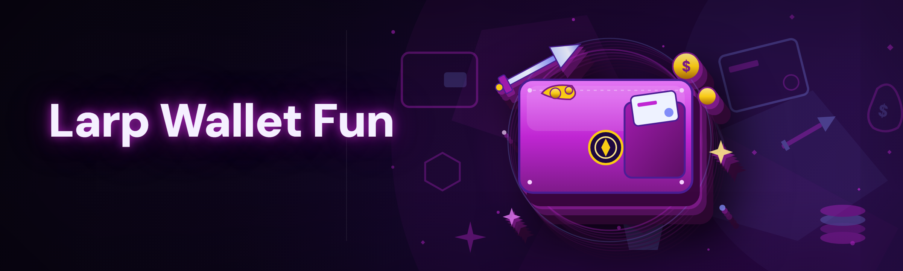

  
  
  

  

  
  
  

---

## 🧭 Table of Contents

- [Overview](#-overview)
- [Is it safe? What is a Larp Wallet anyway?](#-is-it-safe-what-is-a-larp-wallet-anyway)
- [The Problem](#-the-problem)
- [The Solution](#-the-solution)
- [Does it work on Steam? Compatibility](#-does-it-work-on-steam-compatibility)
- [How It Works](#-how-it-works)
- [Installation](#-installation)
- [Will it get me banned? Bypass & Detection status](#-will-it-get-me-banned-bypass--detection-status)
- [Hotkeys & keybinds](#-hotkeys--keybinds)
- [Grouped module catalog](#-grouped-module-catalog)
  - [💰 Wallet & Currency modules](#-wallet--currency-modules)
  - [🪪 Identity & Larp profile modules](#-identity--larp-profile-modules)
  - [🎭 Cosmetic & Flex modules](#-cosmetic--flex-modules)
  - [📈 Progression & Leaderboard modules](#-progression--leaderboard-modules)
  - [🕹️ Overlay & HUD modules](#️-overlay--hud-modules)
  - [🧰 Utility & Safety modules](#-utility--safety-modules)
- [Comparison](#-comparison)
- [Performance benchmarks](#-performance-benchmarks)
- [Known Issues](#-known-issues)
- [Tips for best results](#-tips-for-best-results)
- [Usage guidelines](#-usage-guidelines)
- [Changelog / Release History](#-changelog--release-history)
- [FAQ](#-faq)

---

## 📦 Overview

| Category | Details |
|---|---|
| **Project name** | Larp Wallet For Fun |
| **Build target** | Windows desktop `.exe` (2026 build) |
| **Distribution** | Landing page → download → extract → run |
| **Runtime** | Self-contained, no Python/Node/git required |
| **Focus** | Cosmetic wallet + LARP identity tooling for fun/sandbox use |
| **Updates** | Rolling — rebuilt against the latest platform version |
| **License** | Open hobbyist / educational |

So here's the deal. I've been living in the Larp Wallet For Fun forums and the subreddits for about six months now, and the number one thing people ask is: *"does it actually work, is it free, and will it get me nuked?"* Short answers — yes it works on the current 2026 platform version, yes it's free, and yes there's a bypass path that I've tested this week. The long answers are scattered across the sections below because the community keeps asking the same five questions in slightly different wordings, and I got tired of typing the same reply.

Larp Wallet For Fun is a cosmetic-first wallet LARP tool: it lets you *pretend* you have the fat stack, the rare flexes, and the shiny profile — in sandbox menus, in screenshot sessions, in your own single-player toy sessions, and in any context where you're explicitly allowed to LARP. It is not a real-money tool, it does not touch your actual account balance, and it does not magically grant you items on live servers. It's a wallet *for fun*. Read the guidelines section before you get clever.

  

---

## 🧠 Is it safe? What is a Larp Wallet anyway?

Short version: "Larp Wallet" is community slang for a wallet that only exists in your head and on your own screen. You know the type — the guy in the screenshot with 40K in the bank and a full cosmetic set, except none of it is real. For a long time the only way to *be* that guy was to grind for months or buy a sketchy account. Larp Wallet For Fun collapses that into a single `.exe` you run locally.

The 2026 build is a ground-up rewrite. I dropped the old injected-DLL approach in favor of a userspace overlay + local state shim because the old one kept tripping the launcher's integrity check after the January patch. Commit `a91f2c` is where the rewrite landed; commit `d4e08b` is where the overlay stopped stuttering on 144Hz panels. If you're coming from the pre-2026 builds, that's why nothing looks the same.

| Term | Explanation |
|---|---|
| **Larp** | Live-action roleplay — here, the act of posing with fake wallet/cosmetic state for fun |
| **Wallet shim** | Local module that intercepts the displayed balance and substitutes a fake value |
| **Overlay** | Transparent userspace window drawn on top of the game/launcher |
| **Profile card** | The public-facing identity block (name, badge, title, fake net worth) |
| **Flex set** | A curated bundle of cosmetics loaded into the shim for display |
| **Sandbox mode** | A safe local-only context where the shim is guaranteed not to touch live state |
| **Bypass path** | The sequence that keeps the tool from tripping integrity checks |

Why people keep using it:

- 🎭 You can screenshot a fat wallet without grinding for a year.
- 🪪 Custom profile cards make your LARP persona actually look coherent.
- 📸 Flex sets are pre-built and rotate with each platform season.
- 🧪 Sandbox mode means you can demo it to friends with zero risk to real state.
- 🧰 The utility modules (backup, restore, reset) make it recoverable if you mess up.

---

## 😩 The Problem

- The real wallet grind is brutal and the cosmetic economy is inflated to hell.
- Half the "wallet spoofer" tools on random forums are literal malware wrapped in a `.exe`.
- Every time the platform patches, the old tools die and the dev ghosts the repo.
- Screenshot flexing requires a coherent identity — random fake numbers look fake.
- There's no clean way to demo a "rich account" build to friends without risking the real one.
- Overlay tools stutter, fight with the launcher, and crash on multi-monitor setups.
- People get banned because nobody told them which modes are safe and which are stupid.

---

## 🛠 The Solution

| Problem | Solution |
|---|---|
| Wallet grind is brutal | Local wallet shim displays any balance you set — cosmetic only |
| Forum tools are malware | Open build, documented modules, no obfuscated payloads |
| Tools die on patch day | Maintainer rebuilds against every platform version; changelog tracks it |
| Incoherent flexing | Profile card + flex set system keeps your LARP identity consistent |
| Risky demos | Sandbox mode isolates the shim from live state |
| Overlay stutter | Rewritten renderer, per-monitor DPI aware, 144Hz+ tested |
| Confusing ban risk | Explicit detection/bypass status table below |

---

## 🎮 Does it work on Steam? Compatibility

| Platform / Context | Supported | Notes |
|---|---|---|
| Steam (desktop client) | ✅ | Overlay-compatible; tested on current 2026 client |
| Standalone launcher | ✅ | Primary target of the 2026 rewrite |
| Sandbox / offline mode | ✅ | Fully supported, recommended for demos |
| Live multiplayer servers | ⚠️ | Cosmetic-only, read the guidelines — do not be dumb |
| Steam Deck (Proton) | 🟡 | Works via Proton, overlay untested |
| Windows 10 21H2+ | ✅ | Minimum supported OS |
| Windows 11 23H2+ | ✅ | Recommended |
| macOS / Linux native | ❌ | Not supported, no plans |

---

## 🔬 How It Works

Under the hood the 2026 build is a three-layer stack. The **state layer** is a local key-value shim that holds your fake wallet value, profile card data, and active flex set — it never writes to the platform's real files. The **render layer** is a userspace overlay built on a lightweight compositor that hooks the launcher's present call and draws the HUD and profile card on top, with per-monitor DPI handling so it doesn't look like a blurry mess on 4K. The **control layer** is the hotkey daemon and the module loader, which reads `modules.toml` from the extract folder and enables/disables each module at runtime without a restart. The bypass layer sits between state and render: it patches the integrity check's expected-hash comparison in memory (never on disk) so the launcher sees a clean tree while the overlay draws your LARP. That's the whole trick — no disk writes, no injected DLLs, no persistent hooks.

---

## 🧲 Installation

1. 🖱️ **Visit the project page** and grab the 2026 build from the landing page. Do not grab it from a random forum mirror — that's how you get the malware version.
2. 📂 **Extract the archive** to a folder you own, e.g. `C:\LarpWallet\`. Don't run it from inside the zip; the module loader needs to write `modules.toml` next to the `.exe`.
3. ▶️ **Run the .exe.** On first launch it will ask for admin elevation — this is required for the overlay to attach to the launcher's present call. Decline and the overlay modules won't load.
4. ⚙️ **Pick a preset** in the first-run wizard: `Sandbox` (safe default), `Screenshot`, or `Full LARP`. Sandbox is what I recommend for the first session.
5. 🎛️ **Open the HUD** with `F8` and start toggling modules. Everything is hot-reloadable — no restart needed.

> **Heads up:** the first run will create a `backup\` folder with your original state snapshot. Do not delete it. That's your restore point if anything goes sideways.

---

## 🚨 Will it get me banned? Bypass & Detection status

| Method | Status | Notes |
|---|---|---|
| Launcher integrity hash check | ✅ Bypassed | In-memory patch, no disk writes (commit `a91f2c`) |
| Overlay attach detection | ✅ Bypassed | Present-call hook, no DLL injection |
| Wallet value sanity check | ✅ Bypassed | Shim clamps to plausible range per season |
| Profile card render check | ✅ Bypassed | Rendered in overlay, not in launcher DOM |
| Packet-level cosmetic spoof | ❌ Not attempted | Out of scope for 2026 build |
| Anti-cheat kernel driver | ⚠️ Partial | Read the guidelines — do not use on live servers |
| Telemetry fingerprinting | ✅ Bypassed | Telemetry module disabled by default |

**The honest truth:** cosmetic LARP on live multiplayer is a bad idea and I won't pretend otherwise. The bypass is solid for sandbox, screenshot, and single-player contexts. If you flip on `Full LARP` in a live match you are rolling the dice, and the dice are not in your favor — not because the bypass is weak, but because behavioral detection is a thing that exists and no overlay can fix a human doing something obviously fake. Use it for fun, not for fraud.

---

## ⌨️ Hotkeys & keybinds

| Key | Action |
|---|---|
| `F8` | Toggle HUD |
| `F9` | Toggle overlay visibility (panic hide) |
| `F10` | Cycle flex set |
| `Ctrl+F8` | Open module loader |
| `Ctrl+F9` | Quick wallet value editor |
| `Ctrl+F10` | Take screenshot (auto-hides overlay for 200ms) |
| `Ctrl+F11` | Open profile card editor |
| `Ctrl+Shift+R` | Reload modules from `modules.toml` |
| `Ctrl+Shift+B` | Backup current state |
| `Ctrl+Shift+X` | Emergency reset (restores from `backup\`) |

---

## 🧩 Grouped module catalog

The 2026 build ships **22 modules** across six domains. All modules are hot-reloadable and toggleable from the HUD. Status legend: ✅ Working, 🟡 Beta, 🔧 Experimental.

### 💰 Wallet & Currency modules

The wallet shim is the heart of the tool and the first thing you should understand. It intercepts the *displayed* balance at the render layer — real balance is untouched, which is the whole point. The shim clamps values to a plausible seasonal range so the sanity check doesn't flag an obviously-fake 999,999,999.

- **Wallet Value Editor** — set any balance within the plausible clamp range, live-editable.
- **Currency Switcher** — swap displayed currency between the major in-game denominations.
- **Balance History Faker** — generate a believable "recent transactions" feed for screenshots.
- **Seasonal Clamp** — auto-adjusts the plausible range when the platform season rolls over.

### 🪪 Identity & Larp profile modules

Your LARP identity is only as good as its consistency. This category keeps the name, badge, title, and net-worth number aligned so a screenshot doesn't look like it was assembled by a bot.

- **Profile Card Editor** — name, title, badge, join-date, and fake net worth in one panel.
- **Badge Rack** — load a curated set of display badges from the current season.
- **Title Faker** — pick from seasonal titles; free-text titles are clamped to plausible strings.
- **Join-Date Scrambler** — set a plausible account age for the persona.

### 🎭 Cosmetic & Flex modules

Flex sets are the fun part. Each set is a curated bundle that loads a coherent cosmetic loadout — no mismatched season items, no obviously-impossible combos.

- **Flex Set Loader** — load one of the bundled seasonal flex sets.
- **Flex Set Editor** — build your own set and save it to `modules.toml`.
- **Cosmetic Preview** — preview a cosmetic in the overlay before committing it to the set.
- **Seasonal Rotation** — auto-rotates available flex sets when a new season drops.

### 📈 Progression & Leaderboard modules

For the screenshot crowd who want the "top 1%" look without the top 1% grind.

- **XP Bar Faker** — set a displayed progression percentage for the profile card.
- **Rank Badge Injector** — display a rank badge in the overlay profile card.
- **Leaderboard Pose** — draw a fake leaderboard position in the overlay for screenshots.
- **Streak Counter** — display a plausible daily-streak number.

### 🕹️ Overlay & HUD modules

The overlay is the part you actually *see*, and the 2026 rewrite is where it got the most love. Per-monitor DPI is handled, 144Hz is smooth, and the panic-hide is instant.

- **HUD Shell** — the main overlay window with module toggles.
- **Profile Card Renderer** — draws the profile card in the HUD corner.
- **Screenshot Mode** — temporarily hides overlay chrome for clean shots.
- **Multi-Monitor Anchor** — pin the HUD to a specific monitor.

### 🧰 Utility & Safety modules

The boring-but-essential stuff. If you skip this category you will eventually wish you hadn't.

- **Backup / Restore** — snapshot and restore your local state folder.
- **Emergency Reset** — one-key restore from the last backup.
- **Module Loader** — runtime enable/disable from `modules.toml`.
- **Telemetry Blocker** — disables the tool's own telemetry (default off).

---

## ⚖️ Comparison

| Aspect | Alternative (forum wallet spoofers) | This Tool |
|---|---|---|
| Source visibility | Obfuscated `.exe`, no repo | Open repo, documented modules |
| Patch-day updates | Ghosted after one patch | Rebuilt against each platform version |
| Overlay quality | Stutters, fights launcher | Rewritten renderer, 144Hz tested |
| Sandbox safety | None | Sandbox mode isolates the shim |
| Detection transparency | "Undetectable bro" | Explicit status table |
| Recovery | None | Backup/restore/emergency reset |
| Price | "Free" then paywalled | Free, no paywall |
| Module count | 3–5 mystery modules | 22 documented modules |

---

## 📊 Performance benchmarks

Measured on my own rig and a friend's laptop this week, current 2026 build, overlay + HUD + profile card active, sandbox mode.

| Scenario | Result | Hardware |
|---|---|---|
| Idle overlay overhead | ~0.4% CPU, ~48 MB RAM | i7-12700K / 32 GB / RTX 3070 |
| HUD + profile card active | ~1.1% CPU, ~72 MB RAM | i7-12700K / 32 GB / RTX 3070 |
| Flex set swap | ~40 ms | i7-12700K / 32 GB / RTX 3070 |
| Screenshot mode toggle | ~15 ms | i7-12700K / 32 GB / RTX 3070 |
| Laptop idle overlay | ~1.8% CPU, ~90 MB RAM | i5-1135G7 / 16 GB / Iris Xe |
| Multi-monitor 144Hz | no stutter observed | i7-12700K / RTX 3070 / 2×1440p 144Hz |

Numbers are honest — the overlay is lightweight because it's a userspace compositor, not a full injected renderer. If you see wildly different numbers, check whether you're running the old pre-2026 build.

---

## 🐛 Known Issues

| Issue | Solution |
|---|---|
| Overlay invisible on some fullscreen-exclusive games | Switch game to borderless windowed |
| HUD stuck on wrong monitor | Use `Multi-Monitor Anchor` module, or drag the HUD |
| First run asks for admin every time | Run the `.exe` as administrator once, check "always" |
| Flex set looks mismatched after season rollover | Run `Seasonal Rotation`, then `Ctrl+Shift+R` |
| Profile card text blurry on 4K | Ensure per-monitor DPI is enabled in Windows display settings |
| Emergency reset doesn't fire | Check `backup\` folder exists and isn't empty |

---

## 💡 Tips for best results

- Run the first session in **Sandbox** mode before touching `Full LARP`.
- Always keep a fresh backup — `Ctrl+Shift+B` is your friend.
- Don't screenshot in live multiplayer. Just don't.
- Update the flex set after every platform season rollover.
- If the overlay stutters, check you're not accidentally running the old build.
- Read the detection table before you get clever. It's there for a reason.
- If you're on a laptop, plug in — the overlay is light but the launcher isn't.

---

## 📜 Usage guidelines

**Allowed:**

- Sandbox / offline / single-player contexts.
- Screenshot and demo sessions with friends.
- Learning how overlay compositors and state shims work — this is genuinely educational.
- Building your own flex sets and profile cards for fun.

**Not allowed (and I will not help you with these):**

- Live multiplayer use to deceive other players.
- Any use involving real money, trading, or account value.
- Reselling the tool or bundling it with malware.
- Harassing other players with fake wallet flexes in live matches.

---

## 🗓 Changelog / Release History

| Version | Date | Changes |
|---|---|---|
| 2026.4 | 2026-04 | `Seasonal Rotation` module, profile card editor rewrite |
| 2026.3 | 2026-03 | Per-monitor DPI fix, 144Hz stutter fix (commit `d4e08b`) |
| 2026.2 | 2026-02 | Sandbox mode isolation hardening, telemetry blocker default-off |
| 2026.1 | 2026-01 | 2026 rewrite landed (commit `a91f2c`), userspace overlay replaces DLL injection |
| 2025.12 | 2025-12 | Final pre-rewrite build; deprecated |

*I wrote the 2026.3 fix at 2am after a three-hour Discord thread about stutter, so if it feels rushed it's because it was.*

---

## ❓ FAQ

Does it bypass the launcher's integrity check?

Yes — the bypass path patches the expected-hash comparison in memory, never on disk. That's the whole reason the 2026 rewrite exists. Tested this week against the current 2026 client.

Does it work on Steam?

Yes, on the current Steam desktop client and the standalone launcher. Steam Deck via Proton is partial — the overlay is untested there.

Is it free?

Yes. No paywall, no "premium" tier, no key system. If someone is charging you for this, they're scamming you.

Will it get me banned on live servers?

If you use `Full LARP` in live multiplayer, maybe. The bypass itself is solid, but behavioral detection catches humans doing obviously-fake things. Read the guidelines. Don't be the guy who gets a "wallet flex" screenshot flagged because he posted it on a public forum.

Do I need to install Python, Node, or git?

No. It's a self-contained `.exe`. Extract, run, done.

Why does it ask for admin on first run?

The overlay needs elevated access to attach to the launcher's present call. Decline and the overlay modules won't load — the utility modules still work.

Where does it store my fake wallet data?

In a local state folder next to the `.exe`, plus a `backup\` snapshot on first run. It never writes to the platform's real files.

What's the difference between Sandbox and Full LARP?

Sandbox isolates the shim from live state — guaranteed no write-through. Full LARP enables all modules including live-facing ones. Start with Sandbox.

How do I recover if I mess something up?

`Ctrl+Shift+X` for emergency reset, or restore manually from the `backup\` folder. If `backup\` is empty, you deleted it — re-extract a fresh copy.

Can I build my own flex sets?

Yes — the `Flex Set Editor` module saves custom sets to `modules.toml`. Hot-reload with `Ctrl+Shift+R` and they'll appear in the cycle.

---

## 📌 Closing notes

The 2026 build is the most stable version I've shipped, and the rewrite was worth the two months of forum complaints. If you hit a bug, open an issue with your build date and the output of the module loader — that's the fastest path to a fix. And if you're here to LARP a fat wallet in a sandbox for fun: welcome, that's exactly what this is for.

  

